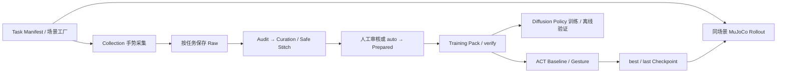

# Paper A：双臂任务的采集、数据与学习工程


本工程将同一套 Panda 双臂控制器、数据处理和策略训练接入任务注册表。现有研究对照为 **ACT Baseline 与 ACT + Gesture 辅助监督**，另提供 **Diffusion Policy（DP）Baseline** 训练入口。三者都只以单 oblique RGB 和机器人状态为策略输入；人手标签只用于 ACT Gesture 的训练辅助监督，DP 本轮不增加手势头。



## 当前任务

| task_id | 场景 | 状态 |
|---|---|---|
| `tray_transfer` | S1：双臂托盘搬运 | ready；完成本次工程全链路检查 |
| `tray_push_then_transfer` | S2：受阻托盘先推移再抓取搬运 | ready；场景加载/初始化回归通过；不是独立纯推移任务 |
| `tray_raised_placement` | S3：放到 25×33 cm、5 cm 高的平台 | ready；加载与既有物理回归通过；尚未在新工程进行真人验收 |
| `tray_to_platform` | 高侧壁空托盘，搬运到28×36 cm、10 cm高的实体高台 | ready；真实双抓→抬升→搬运→落台→松爪DONE工程验证通过；等待真人体验 |
| `lift`、`push` | 未来独立任务占位 | development；明确拒绝启动，尚未实现 |

ready 表示现有实现可加载，不表示新任务的真人采集质量或模型成功率已经验证。新增任务自动发现，不需要修改固定任务枚举。

## 目录职责

| 目录 | 职责 |
|---|---|
| `collection/` | 唯一采集菜单/启动入口；网页与 MediaPipe；调用共享 Recorder |
| `tasks/` | 动态注册、场景参数、任务钩子与来源绑定 |
| `simulation/mujoco/` | 共享 IK、双臂控制、接触保护、Recorder、XML/mesh |
| `dataset/` | 唯一数据管理入口；既有裁剪、Safe Stitch、审核、Prepared、Pack |
| `training/papera/` | 现有 ACT 主体、正式单相机读取、训练/恢复与分析 |
| `training/diffusion/` | 单相机 Diffusion Policy、合法历史/未来窗口、训练与恢复 |
| `rollout/` | 唯一模型检查、预览、固定初态批量评估入口 |
| `config/` | 环境、采集基础、裁剪、训练和评估配置 |
| `assets/models/` | ResNet18 初始预训练资源；不是历史实验权重 |
| `datasets/<task_id>/` | 新采集原件；不自动覆盖 |
| `outputs/{dataset,training,rollout}/<task_id>/` | 按阶段、任务隔离的正式产物 |
| `logs/<task_id>/` | 采集服务与研究诊断 |
| `tests/` | 保留的回归与可复用工程冒烟入口 |
| `.local/checks/` | 工程测试原件、短训模型、报告；不混入正式数据 |

本工程没有导入旧 datasets、outputs 或旧 Git 历史。迁移来源及逐文件对照见 [迁移验收](docs/MIGRATION.md)。

## 环境与最短启动

复用本机 `mujoco_repro` 和 `paperA_train`，解释器及 Node 路径统一在 `config/environments.json`。不用安装另一套 Conda 环境。采集需要摄像头和浏览器授权；本次脚本检查没有代替真人摄像头验收。

```powershell
Set-Location 'D:\轻量化数据采集\paperA'
$envs = Get-Content config/environments.json -Raw | ConvertFrom-Json
$collect = $envs.collection_python
$train = $envs.training_python
& $collect -m collection list
& $collect -m collection start --task tray_transfer --operator-id operator01
```

也可双击 `START-PAPERA.cmd` 或 `collection/START-COLLECTION.cmd`，输入列表中的 task_id。默认网页 `http://127.0.0.1:8014/dual_arm.html`，后端 5014；点击“启动摄像头”后授权。终端保持打开，退出前保存或放弃本轮。端口占用会报错，不会替换未知服务。

采集策略保持迁移前最新的 `palm_fist_level_v2`：100 ms 确认；ILoveYou 控制 XY 并保持爪宽，张掌控制 Z 并匀速打开，握拳控制 Z 并匀速闭合；左右独立。绑定、暂停、丢手恢复和物理保护沿用原实现。

当前网页展示 top/front/oblique 三路（一主画面+两辅助，可切换主视图）；保留自动模式XY看top、Z看front，也可手动选择oblique。当前页面的斜视（side）统一命名为 oblique，oblique 是唯一录制与模型输入视角，top/front 只辅助观察、不录制。完整物理快照、状态、动作和手势日志继续保留。保存视角参数在 `config/recording.json`，新单视角和历史多视角均可审核及构建 Pack，详见全流程命令表第1～2节。

体验新高台任务：双击启动器后输入 **`tray_to_platform`**，或运行 `& $collect -m collection start --task tray_to_platform --seed 0 --operator-id operator01`。物体先在原桌面，抓稳后需要把底面抬过0.45 m台顶再搬运。几何、参数与物理验收见 [全流程命令第7.1节](docs/RUN_PIPELINE.md#71-高侧壁托盘到10厘米高台tray_to_platform)。脚本物理成功不代表真人遥操作或ACT模型成功；本轮没有正式训练。

ACT Baseline/Gesture 与 DP 正式默认统一为单 oblique RGB 640×480、单帧观察、30Hz模型动作、K30动作块和40,000次参数更新；DP 的 `model.observation_horizon=1`。物理仿真500Hz、控制器60Hz，每个模型动作目标执行2个控制tick。对照实验使用同一Pack、split、相机和预算。

先采集至少两个独立会话，再按 [全流程命令](docs/RUN_PIPELINE.md) 构建 Pack、运行 ACT Baseline/Gesture 或 DP。DP 先用 `& $train -m training.diffusion --task $task --pack $pack --check-only` 只读检查，再去掉 `--check-only` 启动训练；默认参数见 `config/training_diffusion.json`，正式输出为 `outputs/training/<task>/diffusion/<run_id>`，支持 `--resume <run/checkpoints/last.pt>`。现有 `rollout` 只支持 ACT；DP 的离线误差不代表自主成功率。工程检查与正式长训练分开，长训练由你手动启动。

- 新任务接入：[ADD_TASK.md](docs/ADD_TASK.md)
- 全流程命令、参数、VS Code、恢复训练：[RUN_PIPELINE.md](docs/RUN_PIPELINE.md)
- 字段、时间轴、任务隔离：[DATA_CONTRACT.md](docs/DATA_CONTRACT.md)
- 实际迁移清单、验证与限制：[MIGRATION.md](docs/MIGRATION.md)
