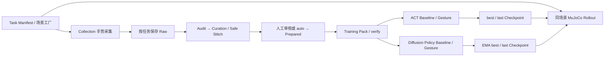

# Paper A：双臂任务的采集、数据与学习工程


本工程将同一套 Panda 双臂控制器、数据处理和策略训练接入任务注册表。研究对照为 **ACT Baseline / ACT + Gesture** 和 **Diffusion Policy（DP）Baseline / DP + Gesture**。四组部署时都只输入单 oblique RGB 和机器人状态；手势类别仅在辅助模型训练时使用，不作为推理输入。设计、标签含义和公平对照约束见 [Gesture 辅助监督](docs/GESTURE_AUXILIARY_EXPERIMENT.md)。



## 当前任务

| task_id | 场景 | 状态 |
|---|---|---|
| `tray_transfer` | S1：双臂托盘搬运 | ready；完成本次工程全链路检查 |
| `tray_push_then_transfer` | S2：受阻托盘先推移再抓取搬运 | ready；场景加载/初始化回归通过；不是独立纯推移任务 |
| `tray_raised_placement` | S3：放到 25×33 cm、5 cm 高的平台 | ready；加载与既有物理回归通过；尚未在新工程进行真人验收 |
| `tray_to_platform` | 高侧壁空托盘，搬运到28×36 cm的实体高台，当前高度3 cm | ready；已有真人示范及模型闭环评估，结果与范围见第6.4节 |
| `lift`、`push` | 未来独立任务占位 | development；明确拒绝启动，尚未实现 |

ready 表示现有实现可加载，不表示新任务的真人采集质量或模型成功率已经验证。新增任务自动发现，不需要修改固定任务枚举。

## 目录职责

| 目录 | 职责 |
|---|---|
| `collection/` | 唯一采集菜单/启动入口；网页与 MediaPipe；调用共享 Recorder |
| `tasks/` | 动态注册、场景参数、任务钩子与来源绑定 |
| `simulation/mujoco/` | 共享 IK、双臂控制、接触保护、Recorder、XML/mesh |
| `dataset/` | 唯一数据管理入口；既有裁剪、Safe Stitch、审核、Prepared、Pack |
| `training/papera/` | 现有 ACT 主体、正式单相机读取、训练/恢复与分析 |
| `training/diffusion/` | 单相机 Diffusion Policy、合法历史/未来窗口、训练与恢复 |
| `rollout/` | 唯一模型检查、预览、固定初态批量评估入口 |
| `config/` | 环境、采集基础、裁剪、训练和评估配置 |
| `assets/models/` | ResNet18 初始预训练资源；不是历史实验权重 |
| `datasets/<task_id>/` | 新采集原件；不自动覆盖 |
| `outputs/{dataset,training,rollout}/<task_id>/` | 按阶段、任务隔离的正式产物 |
| `logs/<task_id>/` | 采集服务与研究诊断 |
| `tests/` | 保留的回归与可复用工程冒烟入口 |
| `.local/checks/` | 工程测试原件、短训模型、报告；不混入正式数据 |

本工程没有导入旧 datasets、outputs 或旧 Git 历史。迁移来源及逐文件对照见 [迁移验收](docs/MIGRATION.md)。

## 环境与最短启动

复用本机 `mujoco_repro` 和 `paperA_train`，解释器及 Node 路径统一在 `config/environments.json`。不用安装另一套 Conda 环境。采集需要摄像头和浏览器授权；本次脚本检查没有代替真人摄像头验收。

```powershell
Set-Location 'D:\轻量化数据采集\paperA'
$envs = Get-Content config/environments.json -Raw | ConvertFrom-Json
$collect = $envs.collection_python
$train = $envs.training_python
& $collect -m collection list
& $collect -m collection start --task tray_transfer --operator-id operator01
```

也可双击 `START-PAPERA.cmd` 或 `collection/START-COLLECTION.cmd`，输入列表中的 task_id。默认网页 `http://127.0.0.1:8014/dual_arm.html`，后端 5014；点击“启动摄像头”后授权。终端保持打开，退出前保存或放弃本轮。端口占用会报错，不会替换未知服务。

采集策略保持迁移前最新的 `palm_fist_level_v2`：100 ms 确认；ILoveYou 控制 XY 并保持爪宽，张掌控制 Z 并匀速打开，握拳控制 Z 并匀速闭合；左右独立。绑定、暂停、丢手恢复和物理保护沿用原实现。

当前网页展示 top/front/oblique 三路（一主画面+两辅助，可切换主视图）；保留自动模式XY看top、Z看front，也可手动选择oblique。当前页面的斜视（side）统一命名为 oblique，oblique 是唯一录制与模型输入视角，top/front 只辅助观察、不录制。完整物理快照、状态、动作和手势日志继续保留。保存视角参数在 `config/recording.json`，新单视角和历史多视角均可审核及构建 Pack，详见全流程命令表第1～2节。

体验高台任务：双击启动器后输入 **`tray_to_platform`**，或运行 `& $collect -m collection start --task tray_to_platform --seed 0 --operator-id operator01`。当前 `tasks/tray_to_platform/scene.json` 的平台高度为0.03 m，加上0.35 m桌面，台顶为0.38 m；搬运时托盘底部需要高于台顶并留出间隙。几何、参数与物理验收见 [全流程命令第7.1节](docs/RUN_PIPELINE.md#71-高侧壁托盘到高台tray_to_platform)，学习模型结果见[第6.4节](docs/RUN_PIPELINE.md#64-四组模型的固定对照与结果查看)。脚本物理验收与学习模型自主成功率分别记录。

ACT Baseline/Gesture 与 DP 正式默认使用单 oblique RGB 640×480、30Hz模型动作、K30动作块、batch16和40,000次参数更新。ACT观察当前1帧；DP观察过去至当前2帧（仍为同一摄像头，`model.observation_horizon=2`），U-Net通道为 `[256,512,1024]`。物理仿真500Hz、控制器60Hz，每个模型动作目标执行2个控制tick。同模型 Baseline/Gesture 对照须使用相同数据、split、历史长度、主干和预算；ACT与DP历史长度不同，跨算法比较应披露，不能称输入信息完全相同。

当前优化对照另将ACT两组按相同方案从40,000步续训至60,000步，DP两组保持40,000步。训练预算与最终选用权重步数分开记录；`best.pt`的离线损失最优不等于物理任务成功率最高。复用本轮模型时须同时使用其冻结的评估配置，不能只换checkpoint而退回旧执行方式，见[四组模型的固定对照](docs/RUN_PIPELINE.md#64-四组模型的固定对照与结果查看)。

2026-11-04已完成四组各50次、同初态、60秒仿真上限、CUDA推理评估：ACT Baseline **45/50（90%）**，ACT + Gesture **40/50（80%）**，DP Baseline **17/50（34%）**，DP + Gesture **3/50（6%）**。当前手势辅助设计未带来收益；只有一个训练seed，不作普遍优劣结论。实际部署权重分别为40k、40k、40k EMA、18k EMA；ACT的60k预算与选中的40k权重分别保留。模型、视频和曲线统一入口：[本轮结果索引](outputs/rollout/tray_to_platform/comparison_20261104/manifest.json)。

2026-11-03 的托盘候选已按用户决定排除8条，冻结64条、60,035帧，以及49条训练/15条验证的整会话划分。`SELECTION_CURRENT.json` 导航选样；`PREPARED_CURRENT.json` 导航正式导出；`TRAINING_PACK_CURRENT.json` 导航模型实际输入。它们都位于 `outputs/dataset/tray_to_platform/`，选样清单本身不是Training Pack。多个采集来源由同一个 `prepare --run <多个Curation> --recorded-collection` 入口联合，保留每条原采集绑定；ACT/DP继续读取同一个正式Pack，不维护第二套Reader。排除范围、命令及边界见全流程命令第2～4节。

该联合Pack已实际完成：`outputs/dataset/tray_to_platform/training_packs/auto_20261103_213247_870817`，`complete=true`、`data_ready=true`。它采用自动裁剪，未冒充全量人工质量批准；`training_ready=false` 保留这项质量审核提示，现有探索性Baseline入口允许显式选用auto Pack。本轮已按用户授权完成四组训练；新的训练仍需显式启动。

同伴数据须由本工程的同任务、相同物理场景/模型相机和S16/A14契约采集，并提供完整会话（data、meta、episode_videos、research及物理快照）。不依赖操作者姓名或固定会话编号；已支持的手势置信度门槛差异会按冻结记录解释。只有MP4、缺日志的合并Parquet、不同机器人/任务/相机不能自动冒充同一数据契约。接收外部完整目录可用 `process --source <目录> --recorded-collection`，无需修改源码中的路径。

先采集至少两个独立会话，再按 [全流程命令](docs/RUN_PIPELINE.md) 构建 Pack、运行 ACT Baseline/Gesture 或 DP。DP 先用 `& $train -m training.diffusion --task $task --pack $pack --check-only` 只读检查，再去掉 `--check-only` 启动训练；默认参数见 `config/training_diffusion.json`，正式输出为 `outputs/training/<task>/diffusion/<run_id>`，支持 `--resume <run/checkpoints/last.pt>`。统一 `rollout` 已支持 ACT 和 DP：DP 使用EMA权重，每30Hz观察更新H2历史，按8步动作块滚动执行。两者离线误差都不是自主成功率；物理执行器与任务成功判据共用。`scripts/run_baseline_campaign.py`是初次训练后固定评估离线best的流程，不负责本轮闭环候选选型；复用已选模型请使用第6.4节的manifest命令，避免误用旧best或默认评估配置。

- 新任务接入：[ADD_TASK.md](docs/ADD_TASK.md)
- 全流程命令、参数、VS Code、恢复训练：[RUN_PIPELINE.md](docs/RUN_PIPELINE.md)
- 字段、时间轴、任务隔离：[DATA_CONTRACT.md](docs/DATA_CONTRACT.md)
- 实际迁移清单、验证与限制：[MIGRATION.md](docs/MIGRATION.md)


## 采集保存使用独显（2026-11-03）

本机已将`config/environments.json`指定的`D:/Conda/envs/mujoco_repro/python.exe`设置为当前Windows用户的高性能图形应用。新启动的采集/快照保存进程已验证使用NVIDIA RTX5090 OpenGL；无需修改帧率、相机或数据格式。相同1107帧整段重放核显36.79/39.44秒，正式解释器切独显后4.49秒；两份视频均完整解码1107帧，状态/动作一致。此耗时不含人手会话日志导出及完整网页请求过程，下一次真人保存用于确认端到端体验。设置、备份、恢复和更换电脑说明见`docs/RUN_PIPELINE.md`末尾同名节；工程证据在`.local/checks/collection-nvidia-20261103/`。
